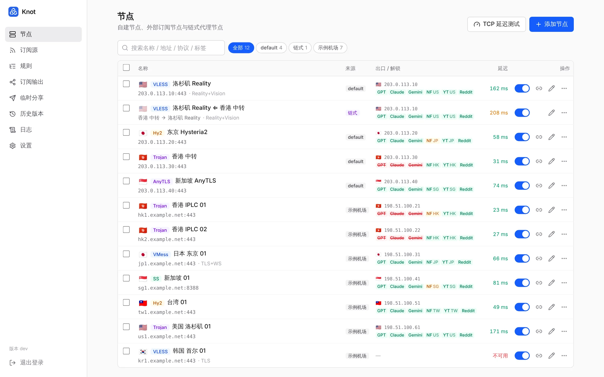
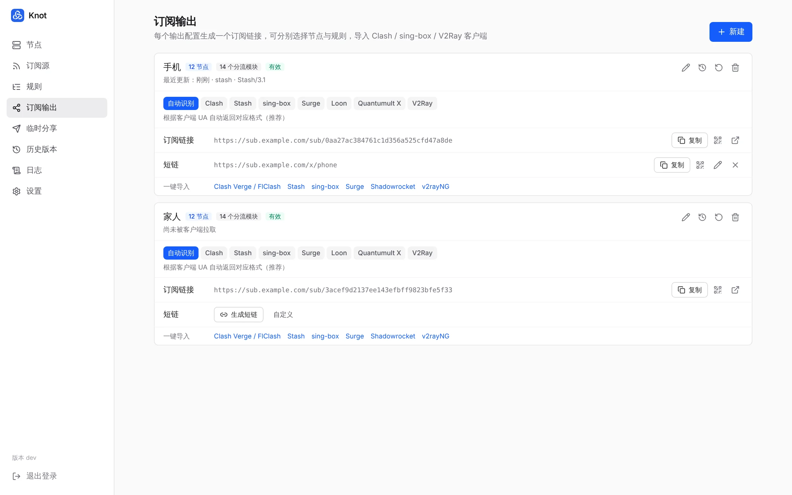
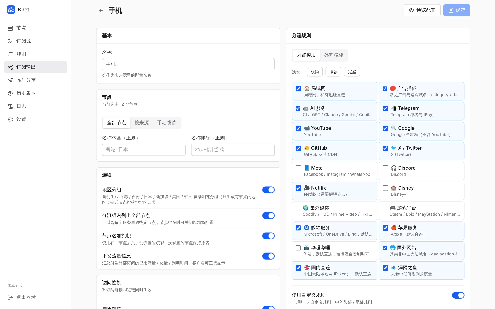
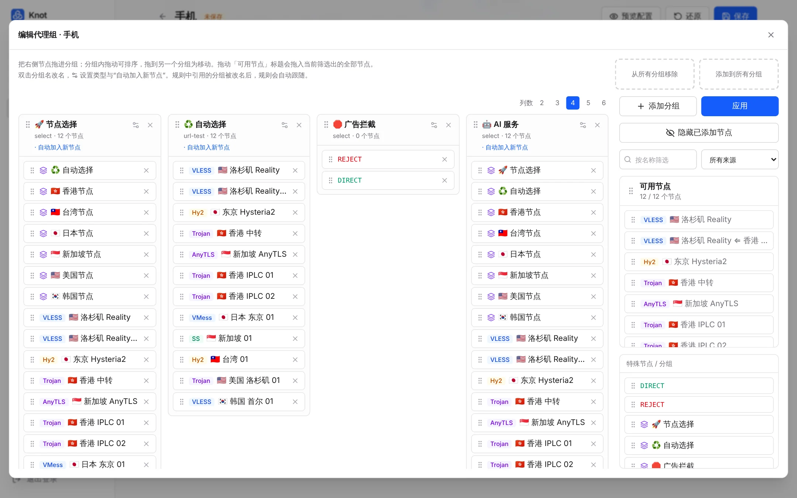
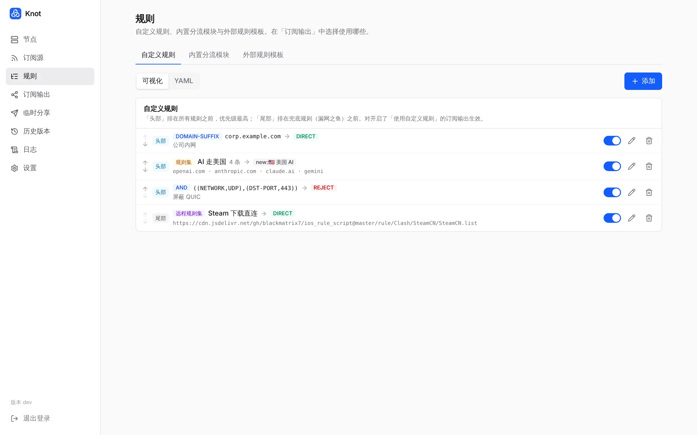
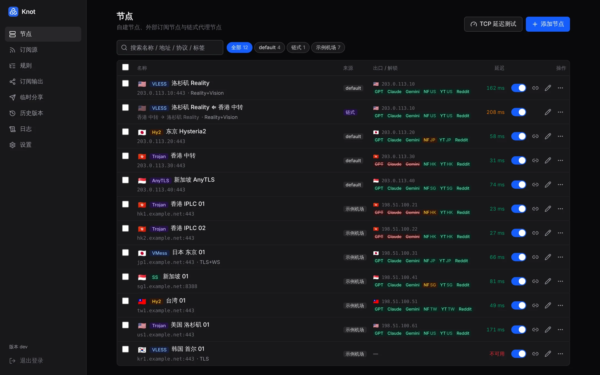
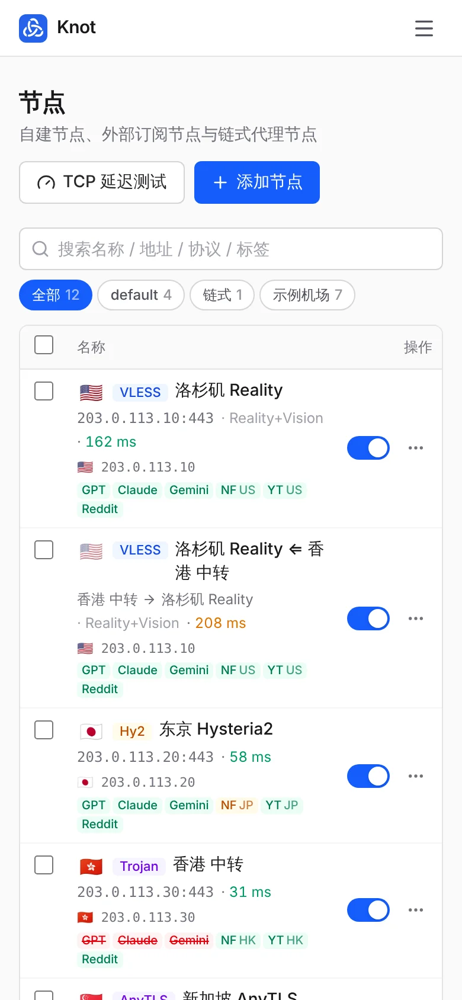

<div align="center">


# Knot

自托管的订阅聚合与转换工具

把自建节点和机场订阅放在一起管理，配置链式代理与分流规则，<br />
生成一个订阅链接导入 Clash / mihomo、Stash、sing-box、Surge、Loon、Quantumult X 与 V2Ray 系客户端。

</div>



## 特性

- **一个链接，多种客户端**：按客户端 UA 自动返回 Clash YAML、sing-box JSON、Surge / Loon / QX 配置或 Base64 分享链接
- **自建节点 + 机场订阅**：支持主流协议的分享链接、Base64、Clash YAML、sing-box JSON 导入；机场订阅定时更新
- **链式代理**：任意节点一键生成「本机 → 中转 → 落地」链式节点，支持多级链，落地节点更新后自动跟随
- **分流规则**：内置分流模块（基于 MetaCubeX 规则集），也可以写自定义规则或导入 ACL4SSR / subconverter 模板
- **代理组拖拽编辑**：把节点拖进分组、排序、批量增删
- **真实测速与解锁检测**：经 mihomo 内核测延迟，并检测 ChatGPT、Claude、Gemini、Netflix、YouTube Premium、Reddit 解锁情况
- **访问控制与审计**：短链、有效期、拉取次数、频率限制、IP 白名单；记录每次订阅拉取和面板登录
- **轻量**：单个 Docker 容器，数据存为 JSON 文件，无需数据库，常驻内存约 80MB
- 两步验证、通行密钥、历史版本、S3 定时备份、手机端与深色模式

## 截图

| 订阅输出 | 编辑订阅输出 |
|---|---|
|  |  |
| **代理组拖拽编辑** | **自定义规则** |
|  |  |
| **深色模式** | **手机端** |
|  |  |

## 快速开始

### Docker Compose（推荐）

```bash
mkdir knot && cd knot
curl -O https://raw.githubusercontent.com/luoxiaoxin123/knot/main/docker-compose.yml
docker compose up -d
```

打开 `http://服务器IP:3000`，首次访问时设置管理密码。数据保存在 `./data/db.json`。

更新到最新版本：

```bash
docker compose pull && docker compose up -d
```

### Docker

```bash
docker run -d --name knot --restart unless-stopped \
  -p 3000:3000 -v $(pwd)/data:/data \
  ghcr.io/luoxiaoxin123/knot:latest
```

镜像支持 amd64 / arm64，已内置 mihomo 内核。

### 从源码运行

需要 Node.js 22.19+。真实测速和解锁检测需要 [mihomo](https://github.com/MetaCubeX/mihomo/releases) 内核（放到 PATH，或用 `MIHOMO_PATH` 指定）；没有内核时退回 TCP 握手延迟。

```bash
npm ci
npm run build
DATA_DIR=./data PORT=3000 npm start
```

### 环境变量

| 变量 | 默认值 | 说明 |
|---|---|---|
| `PORT` | `3000` | 监听端口 |
| `HOST` | `0.0.0.0` | 监听地址 |
| `DATA_DIR` | `./data`（镜像内为 `/data`） | 数据目录 |
| `ADMIN_PASSWORD` | — | 首次启动时设置管理密码（已设置过则忽略） |
| `MIHOMO_PATH` | — | mihomo 内核路径（镜像内为 `/usr/local/bin/mihomo`） |
| `NODE_USE_ENV_PROXY` + `HTTPS_PROXY` | — | 服务器拉取订阅 / 模板需要走代理时设置 |

### 反向代理（HTTPS）

建议放在 HTTPS 反向代理后面，并在「设置 → 对外访问地址」填写域名，订阅链接会使用这个地址。通行密钥登录也需要 HTTPS。

<details>
<summary>Caddy</summary>

```
sub.example.com {
    reverse_proxy 127.0.0.1:3000
}
```

</details>

<details>
<summary>Nginx</summary>

```nginx
server {
    listen 443 ssl http2;
    server_name sub.example.com;
    # ssl_certificate ...;
    location / {
        proxy_pass http://127.0.0.1:3000;
        proxy_set_header Host $host;
        proxy_set_header X-Real-IP $remote_addr;
        proxy_set_header X-Forwarded-For $proxy_add_x_forwarded_for;
        proxy_set_header X-Forwarded-Proto $scheme;
    }
}
```

</details>

## 使用流程

1. **节点** → 添加节点：粘贴自建节点的分享链接
2. **订阅源** → 添加订阅：填写机场订阅链接（可选）
3. **节点** → 在落地节点上点「链」图标（手机上在「⋯」菜单里），选择中转节点，生成链式节点（可选）
4. **规则** → 添加自定义规则（可选）
5. **订阅输出** → 编辑配置：选择节点、勾选分流模块，点击右上角「保存」→ 复制链接导入客户端

## 功能说明

### 节点

- 支持 `vless` `vmess` `trojan` `ss`（含 SS2022 / obfs / v2ray-plugin）`ssr` `hysteria2`（含端口跳跃）`hysteria` `tuic` `anytls` `wireguard` `socks5` `http` 分享链接，以及 Base64 订阅内容、Clash YAML、sing-box JSON
- 启用 / 停用、标签、批量操作、复制分享链接、二维码、直接编辑 YAML
- 自建节点可以分组管理（默认分组为 default，可改名、新建、移动节点）
- 旗帜在「节点」页手动设置（可批量），输出时加在节点名前；不按 IP 或名称自动猜测，避免中转导致地区不准
- **临时分享**：勾选节点生成一次性 / 限次 / 限时的分享链接，可随时作废，带访问记录

### 真实测速与解锁检测

- 经 mihomo 内核通过节点实际发起请求测速，支持 Hysteria2 / TUIC 等 UDP 协议和链式代理
- 检测落地出口 IP / 地区，以及 ChatGPT（网页 / App）、Claude、Gemini、Netflix（全解锁 / 仅自制剧）、YouTube Premium、Reddit 是否可用
  - Claude：看 claude.ai 是否跳转到「地区不可用」页面，DNS 解锁也能正确识别
  - Gemini：按 Google 服务器实际识别的地区判断，DNS 解锁同样适用
  - 信息不足时显示「无法判断」，不会误报为不可用

### 外部订阅

- 支持 Clash / Base64 / 分享链接 / sing-box 格式，可自定义 User-Agent
- 定时自动更新；保留 / 排除正则（默认过滤「剩余流量 / 到期」等提示节点）；名称前缀
- 显示流量与到期时间，并可通过 `Subscription-Userinfo` 透传给客户端
- 订阅更新时尽量保持节点 ID 不变，依赖它的链式代理不会失效

### 链式代理

- 支持多级链（中转节点本身也可以是链式节点），自动检测循环引用
- 链式节点的配置在导出时从落地节点实时派生：落地节点换端口 / 换 IP 后，链式节点自动跟着变
- 中转节点即使没有被订阅输出选中，也会自动写入配置（只放在 `proxies`，不进分组）
- 地区分组按落地节点判断；链式节点没有单独设置旗帜时沿用落地节点的旗帜
- Clash 输出为 `dialer-proxy`，sing-box 输出为 `detour`，Surge 输出为 `underlying-proxy`；V2Ray 链接无法表达链式代理，会自动跳过

### 分流规则

- **内置分流模块**：在每个订阅输出里勾选启用，提供「极简 / 推荐 / 完整」预设（见下方[内置分流规则](#内置分流规则)）
- **自定义规则**：可视化编辑与 YAML 编辑两种模式，每条规则可单独启用 / 停用、调整顺序，可选择添加至头部（最高优先级）或尾部（兜底之前）
  - 规则集：起个名字，一次粘贴多条规则（YAML 列表、Clash 规则文件的 `payload:` 或纯文本），每行 `类型,值[,策略][,no-resolve]`
  - 远程规则集：yaml / text / mrs，domain / ipcidr / classical
  - 支持 mihomo 的全部规则类型，包括逻辑规则 AND / OR / NOT；其他客户端不支持的类型会在生成时跳过并给出提示
  - 策略可以是分组、DIRECT、REJECT 或具体节点；填写不存在的名字会自动新建分组
  - GEOSITE / GEOIP 规则自动转换为 MetaCubeX 规则集，客户端无需下载完整的 geosite.dat
- **外部规则模板**：导入 subconverter / ACL4SSR 的 `.ini`，或任意 Clash YAML（包括机场的 Clash 订阅），其中的节点会替换为你自己的节点

### 代理组

- 默认根据分流模块 / 模板自动生成
- 也可以切换为自定义：在可视化编辑器里把节点拖进分组、组内排序、跨组移动，双击改名，切换 select / url-test / fallback / load-balance
- 分组可设置「自动加入新节点」（可按名称正则筛选），手动移除的节点不会被加回
- 规则引用的分组改名后规则自动跟随；被删除的分组在生成时会自动补回，保证配置可用

### 订阅输出

- 可创建多个输出（例如「手机」「家人」），分别选择节点（全部 / 按来源 / 手动挑选 + 正则过滤）与规则
- 编辑后需要点击页面右上角的「保存」才会生效；未保存直接离开时会提示，修改不会保存
- 短链：`/x/xxxxxxxx`，可自定义（如 `/x/phone`）
- 访问控制：启用 / 停用、有效期、最多拉取次数、每小时频率限制、IP 白名单
- 自动地区分组（香港 / 台湾 / 日本 / 新加坡 / 美国 / 韩国）
- 覆写 YAML：与生成的配置深度合并，可修改端口、DNS、TUN 等任意字段
- 预览各客户端的生成结果并显示转换警告；一键导入链接、二维码；链接泄露时可以重置

### 安全与审计

- 两步验证（TOTP，兼容 Google Authenticator / 1Password / Bitwarden 等）+ 8 个一次性恢复码
- 通行密钥（Passkey）：指纹 / 面容 / 安全密钥直接登录
- 登录失败 10 次封禁该 IP 10 分钟
- 日志：订阅拉取（IP、客户端、格式、被拒绝原因）、面板登录、敏感操作（改密码、恢复备份、重置链接等），可设置保留天数

### 历史版本、备份与迁移

- 输出配置、自定义规则、规则模板、自建 / 链式节点每次修改自动保存版本，可查看差异并一键恢复（订阅链接保持不变）
- 备份到 S3 兼容对象存储（AWS S3 / Cloudflare R2 / MinIO / 阿里云 OSS / 腾讯云 COS / Backblaze B2 等），支持定时备份、保留份数、一键恢复；也可以下载 / 上传 JSON 备份
- 从 **Sub-Store** 备份导入：远程订阅 → 订阅源，本地订阅 → 节点，组合订阅 → 输出配置
- 从 **妙妙屋（miaomiaowu）** 的 `traffic.db` 导入：节点、链式代理、外部订阅

## 客户端支持

| 格式 | 说明 |
|---|---|
| Clash / mihomo | 完整配置，mrs 规则集，支持全部协议与链式代理 |
| Stash | Clash 兼容格式，自动转换字段差异（Hysteria2 `auth`、TUIC v5 等），规则集使用文本格式 |
| sing-box | 1.12+ 格式，srs 规则集，链式代理使用 `detour` |
| Surge | 完整托管配置（`#!MANAGED-CONFIG` 自动更新），支持链式代理；不支持 VLESS |
| Loon | 完整配置，支持 VLESS Reality / Hysteria2；不支持 TUIC、链式代理 |
| Quantumult X | 完整配置，支持 VLESS Reality；不支持 Hysteria2 / TUIC、链式代理 |
| V2Ray | Base64 分享链接（v2rayN / v2rayNG / Shadowrocket / NekoBox） |

生成的 Clash 与 sing-box 配置均通过 mihomo / sing-box 内核校验。Surge / Loon / QX 的分流规则使用 [blackmatrix7/ios_rule_script](https://github.com/blackmatrix7/ios_rule_script) 中对应格式的规则集；只需要节点、不需要规则时，在链接后加 `&list=1`。客户端不支持的节点会被跳过，并在「预览配置」里列出原因。

同一个链接按 UA 返回对应格式，也可以用 `?target=` 指定（`clash` `stash` `singbox` `surge` `loon` `qx` `v2ray`）：

| UA 包含 | 返回格式 |
|---|---|
| stash | Stash |
| surge | Surge |
| loon | Loon |
| quantumult | Quantumult X |
| sing-box / SFA / SFI / SFM | sing-box JSON |
| clash / mihomo / verge / flclash / nyanpasu / hiddify | Clash YAML |
| 其他（v2rayN / v2rayNG / Shadowrocket / NekoBox …） | Base64 分享链接 |

## 内置分流规则

规则源使用 [MetaCubeX/meta-rules-dat](https://github.com/MetaCubeX/meta-rules-dat)：域名数据来自 [v2fly/domain-list-community](https://github.com/v2fly/domain-list-community)，IP 数据来自 Loyalsoldier GeoIP，每天自动构建。mihomo 使用 `.mrs`、sing-box 使用同源的 `.srs`，两种客户端的分流行为一致。

规则按以下顺序匹配：

| 顺序 | 模块 | 规则 | 默认 |
|---|---|---|---|
| — | 自定义头部规则 | | |
| 1 | 🏠 局域网 | geosite:private、geoip:private | 固定直连 |
| 2 | 🛑 广告拦截 | geosite:category-ads-all | 拦截 |
| 3 | 🤖 AI 服务 | geosite:category-ai-!cn | 代理 |
| 4 | 📲 Telegram | geosite:telegram、geoip:telegram | 代理 |
| 5 | 📹 YouTube / 🔍 Google / 🐱 GitHub / 🐦 X / 📘 Meta / 🎧 Discord | 对应 geosite | 代理 |
| 6 | 🎥 Netflix / 🏰 Disney+ / 🌍 国外媒体 / 🎮 游戏平台 | 对应 geosite | 代理 |
| 7 | Ⓜ️ 微软 / 🍎 苹果 / 📺 哔哩哔哩 | 对应 geosite | 直连 |
| 8 | 🌐 国外网站 | geosite:geolocation-!cn | 节点选择 |
| 9 | 🎯 国内直连 | geosite:cn、geoip:cn | 直连 |
| — | 自定义尾部规则 | | |
| 10 | 🐟 漏网之鱼 | MATCH | 代理 |

每个非固定模块都会生成一个可在客户端切换的分组。规则集默认通过「🚀 节点选择」下载，也可以在设置里换成 jsDelivr 或自定义加速前缀。

## 常见问题

**临时分享到期后，对方还能用吗？**

分享链接限制的是拉取订阅：次数用完、过期或作废后，对方无法再拉取或更新。但已经导入的节点里包含连接凭据，在你更换该节点的密码 / UUID 之前仍然可以连接。如果需要到期立即断开，请为对方使用独立凭据（例如在 3x-ui 面板里为分享单独创建一个带到期时间的用户）。

**IP 白名单在反向代理后面能用吗？**

能。只有请求来自本机或内网（即经过反向代理）时，才会读取 `X-Forwarded-For` / `X-Real-IP`；直接暴露端口时使用 TCP 连接的来源地址，避免被伪造请求头绕过。

**资源占用如何？**

空闲时约 78MB；1000 个节点连续生成 90 次订阅后约 100MB（Docker 镜像默认用 `--max-old-space-size=128` 限制 V8 堆）。1000 个节点生成一次 Clash 配置约 80ms。测速 / 解锁检测时会临时启动一个 mihomo 进程，结束后退出。

## 开发

```
server/          后端（Hono + Node.js）
  src/core/      解析、转换、配置生成（纯函数，有单元测试）
  src/services/  订阅拉取、测速、S3 备份
shared/          前后端共享类型
web/             前端（React + Tailwind）
```

```bash
npm run dev       # 开发模式：前端 http://localhost:5173，自动代理到后端 3000 端口
npm test          # 单元测试
npm run typecheck # 类型检查
```

## License

[Apache-2.0](LICENSE)
